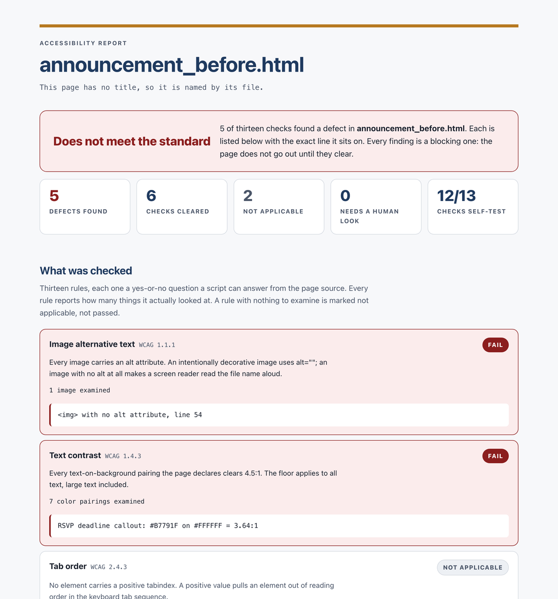

# Accessibility checks for AI-made documents

When Claude makes a document for me, accessibility gets handled twice. First, the rules are
written into the instructions Claude follows while it builds the file: real headings instead
of bold text, alt text on every image, color pairs declared as data and checked against a
contrast floor, and a document title set. Second, after the file is built, a script checks
the finished file and refuses to call it done if anything fails. For a web page it also
writes a report that someone without a technical background can read and act on.

I'm Andrew Park, an executive assistant. The Claude document tools in my office carry the
real versions of these rules and Python check scripts, including the color-contrast check
and the accessibility report shown here. I built them by directing Claude Code. This
repository is a clean public copy.

Everything in this repository is fictional. Cedar Ridge College, its staff and its events
are invented for the samples.



## How it works

| Stage | What happens | Files |
|---|---|---|
| 1. Rules at build time | Claude follows the accessibility rules while it makes the file | [`document_accessibility_rules.md`](rules/document_accessibility_rules.md) |
| 2. Check the finished file | A script opens the file and checks it. Any failure means the file is not done | [`checks/`](checks/) |
| 3. Report | For a web page, a plain-language report of what was checked, what failed and where | [sample report](sample/a11y_report_announcement_before.html) |
| 4. Person | Someone reads what a script cannot judge, such as whether alt text is accurate | |

The rules are there to stop problems before they happen. The checks are there because an
instruction to a model is not a guarantee. The checks only count what a script can prove
from the file. Anything that needs judgment is listed for a person.

## The samples

The sample folder has a one-page event announcement and a memo, each in two versions. The
"before" files contain real defects. The "after" files fix them and pass every check.

| File | Defects in the "before" version |
|---|---|
| [`announcement_before.html`](sample/announcement_before.html) | image with no alt text, gold text on white at 3.64:1, empty page title, no page language, headings that skip a level |
| [`memo_before.docx`](sample/memo_before.docx) | image with no alt text, "Schedule" as bold text instead of a heading, table with no header row, no document title, gold text on white at 3.64:1 |

Running the checks on the before memo:

```
FAIL  sample/memo_before.docx: 1 image(s) with no usable alt text
        - word/document.xml  image id=1 name='Picture 1': no alt text
FAIL  sample/memo_before.docx: 3 structural issue(s)
        - visual heading: bold body paragraph "Schedule" stands over body text with no Heading style (a screen reader reads it as a sentence; the outline skips it)
        - table header: table #1 first row is not marked as a header row (missing w:tblHeader in trPr)
        - title: core properties dc:title is missing or empty
FAIL  sample/memo_before_colors.json
        contrast: RSVP deadline callout: #B7791F on #FFFFFF = 3.64:1 (floor 4.5:1)
```

## What the report shows

A list of green ticks can hide a lot. "All checks passed" reads the same whether a check
looked at eleven images or none. The report is built to avoid that in three ways.

- **It counts what each check examined.** A check with nothing to look at reads "not
  applicable", never passed. Contrast is the exception: every page has text on a
  background, so a page that declares no color pairs reads "not declared", meaning
  unproven.
- **It shows the colors.** Each declared color pair is drawn as a swatch next to its
  measured ratio and how far it sits above or below the 4.5:1 floor.
- **It proves the checks work.** Each time the report runs, it makes a throwaway copy of the
  page for each check, plants one defect of that kind, and confirms the check catches it.
  On the before page, 12 of 13 checks catch their planted defect. The thirteenth, page
  language, reads "not exercised" because the page is already missing its language, so there
  is nothing left to remove.

The report is a web page too, so it has to pass the same checks before it is written.

## What the checks cover

Each check maps to a WCAG 2.x success criterion. These checks cover parts of those criteria
that a script can verify. They do not make a document compliant on their own and are not a
certification.

| WCAG criterion | Web page | Word file |
|---|---|---|
| 1.1.1 Non-text Content | every image has alt text | every image has usable alt text; a file name or "Picture 3" counts as missing |
| 1.3.1 Info and Relationships | no skipped heading levels; tables have headers | heading order; bold text posing as a heading; table header rows |
| 1.4.3 Contrast (Minimum) | declared text color pairs clear 4.5:1 | declared text color pairs clear 4.5:1 |
| 1.4.11 Non-text Contrast | declared icons, rules and borders clear 3:1 | |
| 2.4.1 Bypass Blocks | a main landmark or skip link | |
| 2.4.2 Page Titled | a non-empty page title | the document's Title property is set |
| 2.4.3 Focus Order | no positive tabindex | |
| 2.4.7 Focus Visible | the focus outline is never removed without a replacement | |
| 3.1.1 Language of Page | the page declares its language | the document declares its language |
| 3.1.2 Language of Parts | passages in a second language are marked (warning only) | |
| 4.1.2 Name, Role, Value | buttons and links have names; nothing focusable is hidden | |

The contrast checks read the color pairs declared before the file was built. They do not
measure colors out of the finished file. The two agree because of a rule in the build
instructions: every color in the document comes from the declared list, and none is typed in
anywhere else.

A script cannot tell whether alt text describes the image accurately, whether the reading
order makes sense, or whether an image marked decorative really is. The report lists those
questions for a person, and the build rules end by asking for Word's own accessibility
checker before a file leaves the office.

## How it was built

I designed the two stages and built them by directing Claude Code. A few of the design
decisions:

- Alt text has to say something. PowerPoint, Excel and the Python libraries that write those
  files fill the alt-text field with the file name or a word like "Picture" on their own, so a check that only asked whether the field was
  filled would pass a document a screen reader announces as "Picture, Picture, Picture."
- Bold text standing in for a heading is caught in Word files. It looks right on the page,
  but a screen reader reads it as an ordinary sentence and the document outline skips it.
- A color pair that cannot be measured, such as text over a photo or a gradient, fails
  instead of passing quietly. The build rules ban gradients behind text for that reason.

## Run it yourself

You need Python 3.10 or later and `python-docx`.

```bash
pip install -r requirements.txt

python3 -m checks web sample/announcement_before.html
python3 -m checks docx sample/memo_before.docx --colors sample/memo_before_colors.json
python3 -m checks report sample/announcement_before.html -o my_report.html

python3 -m pytest
```

`web` and `docx` exit 0 when everything passes and non-zero when anything does not, so they
can stop a build. `report` writes its report either way. `python3 sample/build_samples.py` rebuilds the sample memos and images.

To use the rules with Claude, add `rules/document_accessibility_rules.md` to the instructions
of whatever skill or project makes your documents, and change the colors to your own brand.

## What's here

```
rules/document_accessibility_rules.md   the build-time rules Claude follows
checks/web.py                           thirteen checks for a web page
checks/docx_alt.py                      alt text in a Word file
checks/docx_structure.py                headings, table headers, language and title in a Word file
checks/docx_contrast.py                 declared color pairs for a Word file
checks/contrast.py                      the WCAG contrast arithmetic, in one place
checks/report.py                        the plain-language report for a web page
checks/__main__.py                      the one command: web, docx, report
sample/                                 before and after versions of a page and a memo, plus the report
tests/                                  119 tests, run with pytest
docs/                                   screenshot of the report
```

Released under the MIT License.
